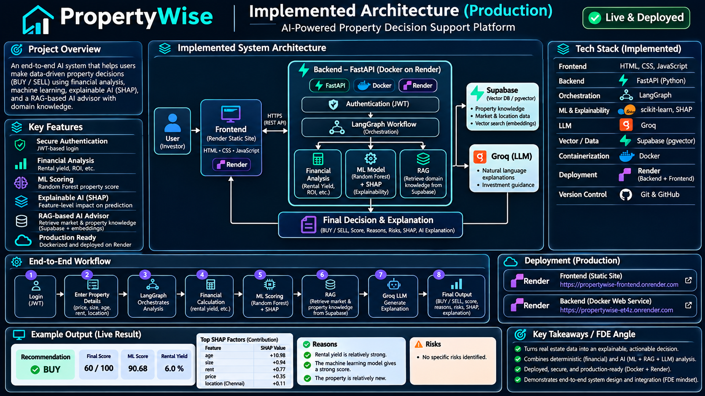

# PropertyWise — AI-Powered Property Decision Support Platform

PropertyWise is an AI-powered property decision-support platform that helps users evaluate whether a property is a potential **BUY or SELL** opportunity.

It combines deterministic financial analysis, machine learning, SHAP explainability, Retrieval-Augmented Generation (RAG), and an LLM to produce an explainable property recommendation.

**Status:** Live and deployed

**Frontend:** https://propertywise-frontend.onrender.com

**Backend API:** https://propertywise-et4z.onrender.com

---

## Architecture



### Production workflow


```text
User
  │
  ▼
Render Static Frontend
  │
  │ HTTPS / REST API
  ▼
FastAPI Backend
  │
  ├── JWT Authentication
  ├── Input Validation / Guardrails
  │
  ▼
LangGraph Workflow
  │
  ├───────────────┬────────────────┐
  ▼               ▼                ▼
Financial       ML Model          RAG
Analysis        Random Forest     Supabase
  │               │              pgvector
  │               ▼                │
  │             SHAP               │
  │               │                │
  └───────────────┴────────────────┘
                  │
                  ▼
               Groq LLM
                  │
                  ▼
        Final Decision & Explanation
                  │
                  ▼
                User
```

---

## What Problem Does It Solve?

Property decisions often involve multiple factors:

- Purchase price
- Property size
- Property age
- Expected rental income
- Rental yield
- Location
- Machine-learning predictions
- Relevant property knowledge

Looking at these factors independently can make the decision difficult.

PropertyWise brings these signals together into a single workflow and produces:

- BUY / SELL recommendation
- Overall decision score
- Rental yield
- ML prediction score
- SHAP-based feature explanations
- Reasons supporting the recommendation
- Identified risks
- AI-generated explanation

The goal is not to replace professional financial, legal, or property advice. It is a **decision-support system** that helps structure the available information.

---

## Key Features

### 1. JWT Authentication

The `/analyze` endpoint is protected using JWT authentication.

```text
Login
  ↓
JWT access token
  ↓
Authenticated API request
  ↓
Property analysis
```

---

### 2. Input Validation

Property inputs are validated before entering the analysis workflow.

Validated inputs include:

- Decision
- Price
- Property size
- Property age
- Expected rent
- Location

Invalid values are rejected before analysis.

---

### 3. Financial Analysis

PropertyWise calculates financial indicators such as rental yield.

Example:

```text
Rental Yield = Annual Rental Income / Property Price × 100
```

This provides a deterministic financial signal that can be combined with the machine-learning result.

---

### 4. Machine Learning

A **Random Forest** model provides a property attractiveness score based on the supplied property features.

The ML score is kept separate from the final decision score.

This is an important design decision:

```text
ML Prediction
      │
      ▼
Structured signal
      │
      ├── Financial analysis
      ├── RAG context
      └── Other decision factors
               │
               ▼
       Final recommendation
```

The LLM does not independently determine the numerical ML score.

---

### 5. SHAP Explainability

PropertyWise uses **SHAP** to explain the contribution of individual features to the machine-learning prediction.

Example:

```text
Feature              Contribution
----------------------------------
age                  +10.98
size                  +0.94
rent                  +0.77
price                 +0.35
location              +0.11
```

This makes the ML component more interpretable than simply returning a prediction.

---

### 6. RAG-Based Property Knowledge

The system uses Retrieval-Augmented Generation to retrieve relevant property knowledge.

The RAG layer is backed by **Supabase pgvector**.

Conceptually:

```text
Property Knowledge
       ↓
Embeddings
       ↓
Supabase pgvector
       ↓
Similarity Retrieval
       ↓
Relevant Context
       ↓
Groq
       ↓
Explanation
```

RAG provides contextual knowledge while the ML model handles structured property scoring.

---

### 7. LangGraph Workflow

LangGraph is used to orchestrate the analysis workflow.

Instead of sending the raw customer input directly to an LLM, PropertyWise processes the request through defined stages:

```text
Property Input
      ↓
Validation
      ↓
LangGraph Workflow
      ↓
Financial Analysis
      ↓
ML Prediction
      ↓
SHAP Explanation
      ↓
RAG Retrieval
      ↓
Groq Explanation
      ↓
Final Response
```

This keeps the workflow structured and easier to reason about.

---

### 8. Groq LLM

Groq is used to generate the natural-language explanation presented to the user.

The LLM receives structured results from the analysis pipeline rather than being responsible for the underlying numerical calculations.

This separation helps keep the system more predictable:

```text
Deterministic / ML components
          ↓
    Structured results
          ↓
        Groq LLM
          ↓
Human-readable explanation
```

---

## Example Result

For a sample property in Chennai, PropertyWise produced:

| Metric | Result |
|---|---:|
| Recommendation | **BUY** |
| Final Decision Score | **60 / 100** |
| ML Score | **90.68** |
| Rental Yield | **6.0%** |
| Location | **Chennai** |

### Reasons

- Rental yield is relatively strong.
- The machine-learning model gives the property a strong score.
- The property is relatively new.

### SHAP factors

| Feature | Contribution |
|---|---:|
| Age | +10.98 |
| Size | +0.94 |
| Rent | +0.77 |
| Price | +0.35 |
| Location — Chennai | +0.11 |

The final decision score and ML score are intentionally different.

The **ML score represents the model's prediction**, while the **final decision score represents the broader decision logic** used by PropertyWise.

---

## Technology Stack

| Layer | Technology | Purpose |
|---|---|---|
| Frontend | HTML, CSS, JavaScript | User interface |
| Backend | Python, FastAPI | REST API |
| Authentication | JWT | Protected API access |
| Validation | Pydantic | Input validation |
| Workflow | LangGraph | Workflow orchestration |
| ML | scikit-learn | Property scoring |
| Explainability | SHAP | ML interpretation |
| RAG | Sentence Transformers | Text embeddings |
| Vector Search | Supabase pgvector | Knowledge retrieval |
| Database | Supabase | Managed data and vector storage |
| LLM | Groq | Natural-language explanation |
| Containerization | Docker | Reproducible deployment |
| Deployment | Render | Production hosting |
| Testing | pytest | Automated testing |
| Version Control | Git, GitHub | Source control |

---

## Security

PropertyWise implements several basic security controls:

- JWT-protected analysis endpoint
- Input validation using Pydantic
- Environment variables for secrets
- Protected backend routes
- CORS configuration
- Safe authentication failure responses
- Secrets excluded from source control

Sensitive configuration is provided through environment variables rather than committed directly to GitHub.

Example:

```text
JWT_SECRET
GROQ_API_KEY
SUPABASE_URL
SUPABASE_KEY
```

---

## Docker

The backend is containerized using Docker.

The Docker image packages:

```text
Python
FastAPI
LangGraph
LangChain
scikit-learn
SHAP
Supabase client
Sentence Transformers
Groq client
Application code
```

This creates a reproducible environment between local development and deployment.

Supabase remains an external managed service rather than being packaged inside the backend container.

---

## Deployment

PropertyWise is deployed as two components on Render.

### Frontend

```text
GitHub
   ↓
Render Static Site
   ↓
PropertyWise Frontend
```

### Backend

```text
GitHub
   ↓
Render Web Service
   ↓
Docker Container
   ↓
FastAPI
```

### Production flow

```text
Browser
   ↓
Render Frontend
   ↓
HTTPS REST API
   ↓
Render FastAPI Backend
   ↓
PropertyWise Analysis Workflow
   ↓
Response
   ↓
Frontend
```

Supabase provides the external database and vector-storage layer.

---

## Local Development

### Backend

```bash
cd backend
```

Create and activate a virtual environment:

```bash
python -m venv venv
```

Windows:

```bash
venv\Scripts\activate
```

Install dependencies:

```bash
pip install -r requirements.txt
```

Run FastAPI:

```bash
uvicorn main:app --reload
```

The API will be available at:

```text
http://127.0.0.1:8000
```

---

### Frontend

From the project root:

```bash
cd frontend
python -m http.server 5500
```

Then open:

```text
http://127.0.0.1:5500
```

The frontend communicates with the configured FastAPI backend.

---

## Project Structure

```text
PropertyWise/
│
├── frontend/
│   ├── index.html
│   ├── script.js
│   └── style.css
│
├── backend/
│   ├── main.py
│   ├── requirements.txt
│   └── ...
│
├── Dockerfile
├── .gitignore
└── README.md
```

---

## API

### Health Check

```http
GET /health
```

Example response:

```json
{
  "status": "healthy"
}
```

### Login

```http
POST /login
```

Returns a JWT access token for an authenticated user.

### Property Analysis

```http
POST /analyze
```

Requires:

```text
Authorization: Bearer <JWT_TOKEN>
```

Example request:

```json
{
  "decision": "buy",
  "price": 5000000,
  "size": 1500,
  "age": 5,
  "rent": 25000,
  "location": "Chennai"
}
```

---

## Engineering Design Decisions

### Why FastAPI?

FastAPI provides a lightweight Python API layer that integrates naturally with the project's machine-learning and AI components.

### Why LangGraph?

LangGraph provides explicit workflow orchestration instead of relying on an uncontrolled sequence of LLM calls.

### Why ML?

The property score should come from a structured machine-learning model rather than asking an LLM to invent a numerical prediction.

### Why SHAP?

SHAP makes the ML prediction more interpretable by showing the contribution of individual features.

### Why RAG?

The ML model provides structured scoring, while RAG provides contextual property knowledge.

### Why Supabase?

Supabase provides managed PostgreSQL and pgvector functionality without requiring a separate vector database.

### Why Groq?

Groq provides fast LLM inference for generating the user-facing explanation.

### Why Docker?

Docker creates a reproducible runtime environment and simplifies deployment.

### Why Render?

For this project, Render provides a straightforward production deployment without introducing unnecessary cloud infrastructure.

---

## FDE Engineering Perspective

PropertyWise was designed with a **Forward Deployed Engineering mindset** rather than as a purely academic ML project.

The system starts with a real customer problem:

> How can a property investor turn multiple sources of property information into a clear and explainable decision?

The implementation connects:

```text
Customer Problem
      ↓
Data / Property Inputs
      ↓
Backend API
      ↓
Business Logic
      ↓
Machine Learning
      ↓
Explainability
      ↓
Knowledge Retrieval
      ↓
LLM
      ↓
Customer-Facing Decision
      ↓
Production Deployment
```

The important engineering principle is that each component has a defined responsibility:

- **FastAPI** — API layer
- **JWT** — authentication
- **Pydantic** — validation
- **LangGraph** — workflow orchestration
- **Financial analysis** — deterministic calculations
- **Random Forest** — structured prediction
- **SHAP** — explainability
- **Supabase pgvector** — contextual retrieval
- **Groq** — natural-language explanation
- **Docker** — reproducible runtime
- **Render** — deployment

This separation makes the system easier to explain, test, maintain, and extend.

---

## Example Interview Explanation

> “PropertyWise is an AI-powered property decision-support platform I built to help users evaluate BUY or SELL decisions. The frontend communicates with a FastAPI backend using REST APIs, with JWT protecting the analysis endpoint.
>
> The request enters a LangGraph workflow where I combine deterministic financial calculations with a Random Forest model. SHAP provides explainability for the model prediction, while a RAG layer backed by Supabase pgvector retrieves relevant property knowledge.
>
> Groq then turns the structured analysis and retrieved context into a user-friendly explanation. The backend is containerized with Docker and deployed on Render, with the frontend deployed separately as a Render static site.
>
> One of my key design decisions was not to let the LLM make the numerical decision itself. The financial calculations and ML model provide structured signals, SHAP explains the model, RAG provides context, and the LLM communicates the result to the user.”
 
---

## Future Improvements

Possible future improvements include:

- More comprehensive property datasets
- Additional financial metrics
- Better model calibration and validation
- More comprehensive property-document ingestion
- User-specific property history
- Production monitoring
- Automated CI/CD
- More advanced authorization
- Improved evaluation of RAG retrieval quality
- Expanded automated test coverage

These are intentionally kept as future improvements rather than being presented as currently implemented features.

---

## Disclaimer

PropertyWise is a software engineering and decision-support project.

Its recommendations should not be treated as professional financial, legal, tax, property, or investment advice.

Users should perform appropriate professional, legal, financial, physical, and market due diligence before making a property decision.

---

## Author

**Gopi**

Computer Engineering Student  
Queen's University Belfast

GitHub: `https://github.com/sainamas`
